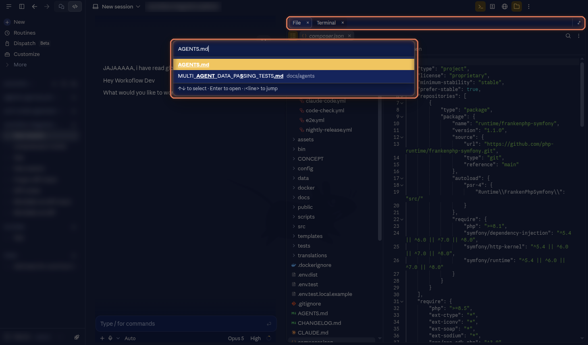
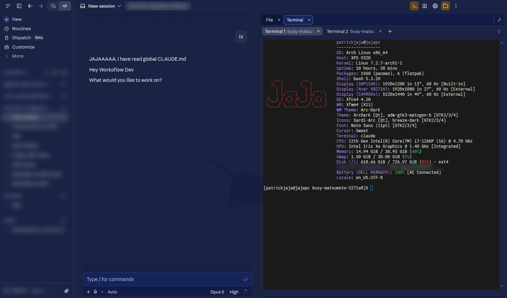

# The Code tab as an IDE

Three switches in Settings → Extra → **Community** make the Code tab work more like VS Code. All three were designed and built by [@dels07](https://github.com/dels07). Each is off by default, applies live, and switching it off leaves the Code tab exactly as Anthropic ships it.

## Files quick open

<kbd>Ctrl</kbd>+<kbd>P</kbd> on the Code tab opens a quick-open box over the Files panel.

- Type part of a name, then pick with the arrow keys and <kbd>Enter</kbd> or the mouse. The file opens as a tab in the Files panel.
- `path:42` opens the file at line 42.
- An empty query lists the files you opened recently.
- Words separated by spaces must all match, in any order: `user service` finds `user-service.spec.ts`. This also fixes the Files panel's own filter and the composer's `@` picker. The space matching reaches the file index on its next start, or after a restart.

It searches Anthropic's own file index, the one behind the Files panel's filter, so results match what the panel shows.

## Panel tabs

The side panels (diff, terminal, browser, files, artifacts, background tasks) open as tabs instead of squeezing into a split.

- Each panel gets the full width of the panel area.
- Open panels the usual way, with the toolbar buttons or the session menu. Each one arrives as a new tab and becomes the active one.
- <kbd>Ctrl</kbd>+<kbd>1</kbd>-<kbd>9</kbd> jumps to a tab. It goes by key position, so AZERTY and similar layouts work too.
- Switching tabs is instant, and every panel keeps its state: the terminal its scrollback, the diff panel its expanded files. A hidden panel keeps running, so a live preview goes on rendering in the background.
- The first panel opens at half the window. Drag the divider to resize; opening or closing a panel does not move it.
- The expand control at the right end of the tab bar spans the active panel across the window, and it stays expanded while you switch tabs.

## Diff view modes

A scope dropdown in the diff panel's header:

| Mode | Shows |
|---|---|
| Working tree | Your uncommitted changes (Anthropic's default) |
| Branch changes | Only the work committed on this branch |
| Latest turn | What Claude changed in its last turn |

The panel compares against the branch you actually forked from, not a guessed default branch. A button next to the dropdown expands or collapses every file. Files keep expanding as they load while it is on, and a file you collapse by hand stays collapsed.

## When something breaks

The Code tab is remote claude.ai code that changes without a desktop release. If an update moves something these features depend on, they step aside and leave the stock layout, then log a `[cdb-tabs]` or `[cdb-qopen]` warning in `claude.ai-web.log`. Please [open an issue](https://github.com/patrickjaja/claude-desktop-extra/issues) with that line.

Patch details: [`patches/community/`](patches.md#community-features).
